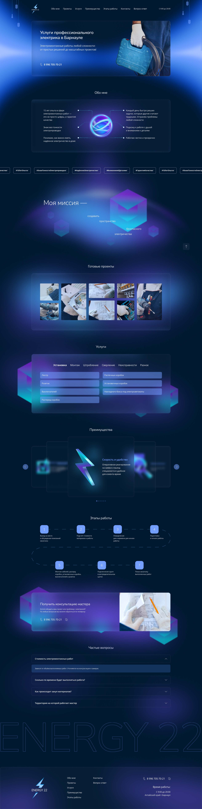

## Energy22-new

Проект содержит в себе вёрстку и логику лендинга Energy22 на библиотеке react. Так же в проект добавлены typescript, prettier и eslint для удобства масштабирования.
Сам проект Energy22-new не выложен на gh pages, но вся вёрстка и логика перенесена на nextjs и задеплоена [тут](https://github.com/sominiac/energy22-next).

Демо билда проекта - https://sominiac.github.io/energy22-next.

### Версия 0.1.1

- Закончена вёрстка desktop версии сайта.
- Добавлена основная логика: news line, anchor links, slider and tabs.

### Что предстоит сделать:
- [ ] Добавить кроссбраузерность.
- [ ] Добавить адаптивную вёрстку под планшеты и телефоны.
- [ ] Внести исправления по внутренним `@TODO`.
- [ ] Исправить видимость лишних слайдов. В секции advantages нужно убрать лишние слайды.
- [ ] Исправить пагинацию. В секции advantages кастомизировать клики на точки пагинации с учётом дублирующихся слайдов. И исправить активную точку с учётом дублей.
- [ ] Скроллбар. Добавить обновлённый скроллбар.
- [ ] Глобально. Добавить реализацию для кнопки "телефон".
- [ ] Поправить расхождения с pixel-perfect.

Полноценный layout всего дизайна, выгружен из фигмы и лежит в репозитории по пути `src/assets/images/template`

